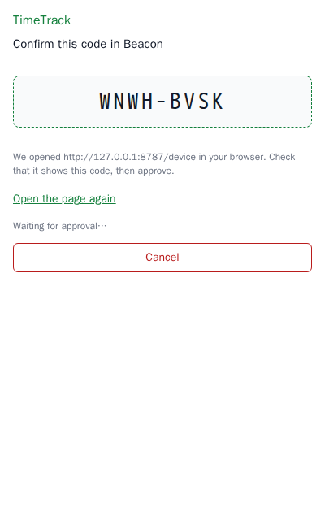
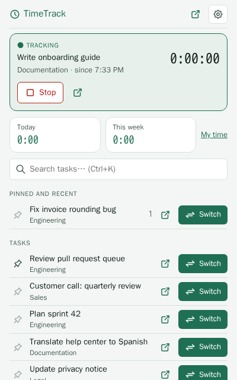

# TimeTrack desktop

Tray app (Tauri 2) to start, stop and switch your [symfony-beacon](https://github.com/nowo-tech/symfony-beacon) time
tracking. Talks to the TimeTrackBundle **1.9.0** client API only. Windows, macOS and Linux. English and Spanish.

 

It records only the time you choose to track — see [PRIVACY.md](PRIVACY.md).

## Install

Download the installer from Beacon → **Tasks → Time → Apps** (`/dashboard/tasks/time/apps`); the page shows the
version and SHA-256 of each file. Version 0.1 is **not code-signed** yet, so the operating system warns once:

| OS | File | First start |
|---|---|---|
| Windows 10/11 | `*-setup.exe` (or `.msi`) | SmartScreen "Windows protected your PC" → **More info** → **Run anyway**. |
| macOS 12+ (Intel and Apple silicon) | `.dmg` | Drag TimeTrack to Applications. First start: right-click (Control-click) the app → **Open** → **Open**. If macOS says the app "is damaged", run `xattr -dr com.apple.quarantine /Applications/TimeTrack.app` once. On macOS 15+: System Settings → Privacy & Security → **Open Anyway**. |
| Linux (x86_64) | `.deb` or `.AppImage` | `sudo apt install ./TimeTrack_*.deb`, or `chmod +x TimeTrack_*.AppImage` and run it. The token is kept in the Secret Service (GNOME Keyring / KWallet). |

Check the SHA-256 shown on the Apps page before installing (`certutil -hashfile <file> SHA256`, `shasum -a 256 <file>`,
`sha256sum <file>`).

### Sign in

1. Enter your Beacon URL and click **Connect**.
2. The app shows a code like `BCDF-GHJK` and opens Beacon's *Connect a device* page in your browser.
3. Check the code, approve. The app is now listed in Beacon under Account → Security → Time tracking apps, where you
   can revoke it. The session token is stored in the OS keychain only.

## Features

- Tray timer (`H:MM` and task, tooltip with today's total) with a translated menu: Stop / Resume, Switch to (pinned and
  recent tasks), Search task…, Open Beacon, My time. Global shortcut **Ctrl/Cmd + Alt + Shift + T**, configurable in
  Settings.
- Pinned and recent tasks (`Alt+1…9`), Resume the last task, Today / This week totals, search with `Ctrl/Cmd + K`, arrow
  keys and Enter.
- Device-flow sign-in (no password typed in the app); `401` asks you to sign in again.
- Task search, start / stop / switch. Offline queue: actions taken offline (and "Still there?" answers) are kept on this
  computer, survive a restart and are replayed in order with their real times (`startedAt` / `endedAt`, TimeTrackBundle
  1.10). When the server moves a time (overlap with the previous entry, backdating limit, clock in the future), the app
  says so in plain words. A 1.9 server records an offline start when the connection returns, and the app says that too.
- **"Still there?"** (Beacon spec 199 block 0): while a timer runs, after N minutes without keyboard or mouse input the
  app asks, calmly and without blocking: *Yes, I'm here* · *I was in a meeting or call* (optional note, or count the time
  on another task on 1.10 servers) · *Discard those minutes* · *Pause the timer*. With no answer within M minutes the timer
  stops at the last input; on return the app asks what to do with the gap, then offers *Resume*. Screen lock and sleep
  count as idle. N and M come from the organisation (`GET me` → `features.idle_check`, `limits.idle_check`; on by
  default there, and the person may only make N longer). On a 1.9 server it is the person's opt-in (default 10 / 5 min).
  The OS idle counter is read locally (`user-idle`) and never stored, logged or sent: only the decision reaches the
  server.
- Privacy screen ("What we collect"): exactly what is sent and what stays on this computer, and **Clear local data**
  (signs out, deletes the token, settings, consents, pinned tasks, queued actions and the idle-check state).
- Optional, off by default, with dated consent: notifications (never outside `me.workingHours`), start at login.
- Auto-update through Beacon (`/api/time-track/updates/desktop/{target}/{arch}/{version}?bundle_type=…`, your token
  as Bearer), signed with the owner's minisign key: checked at start, every 6 h and from *Check for updates* (tray,
  Settings → About). A calm card ("Version X is available — What's new · Update now · Later") downloads with progress,
  verifies, installs and relaunches; with a timer running it asks first and offers *After I stop*. An "update
  required" screen when `min_supported_version` (updater body / `X-Min-Supported-Version` / `GET me`) is newer than the
  app and an update satisfying it is offered; it always keeps *Remind me later*, *Download from Beacon* and *Sign out*.
  The Bearer token is never sent to the artifact host (pre-signed URL on another origin); the device verification page
  is opened only when it is https on the server's host.
- Windows: Microsoft Store (MSIX, updated by the Store) or the per-user NSIS installer from Beacon (no UAC). macOS:
  unsigned, see [first open on macOS](docs/guides/macos-first-open.en.md) ([español](docs/guides/macos-first-open.es.md)).
  Plan and owner steps: [docs/RELEASE-PLAN-0.4.0.md](docs/RELEASE-PLAN-0.4.0.md).
- Links back to Beacon: **Open Beacon** and **My time** in the header (and *Open Beacon* in the tray menu), plus an
  "Open in Beacon" icon on each task and on the running timer when the server sends the task's `url`. Only `https:`
  links on the connected server's origin are shown or opened.
- "What we collect" screen.

## Development

Requirements: Node 24, pnpm (`corepack enable`), Rust stable and the
[Tauri prerequisites](https://v2.tauri.app/start/prerequisites/) (Linux also `libxss-dev libx11-dev libdbus-1-dev`).

```bash
pnpm install
pnpm mock                 # mock TimeTrack 1.9.0 API + Beacon updater route on http://127.0.0.1:8787
pnpm dev                  # UI in a browser (fake platform) on http://127.0.0.1:1420 — handy for UI work
pnpm tauri dev            # the real app
pnpm lint && pnpm typecheck && pnpm test:coverage   # unit tests, ≥ 90% coverage
pnpm exec playwright install chromium && pnpm test:e2e
(cd src-tauri && cargo clippy --all-targets -- -D warnings && cargo test)
```

The mock's device page is `http://127.0.0.1:8787/device` (approve the code shown by the app). `src/api/` is shared
verbatim with [time-track-extension](https://github.com/nowo-tech/time-track-extension).

## Release

Bump `package.json` and `CHANGELOG.md`, merge, push a `vX.Y.Z` tag. `.github/workflows/release.yml` (tags only) builds
Linux and Windows first, macOS (universal) last, then uploads every file to `time-track-clients/desktop/<version>/` and
writes `time-track-clients/desktop/channel/stable.json` last. Updater signing is required: the build fails without
`TAURI_SIGNING_PRIVATE_KEY` or while `src-tauri/tauri.conf.json` still has the updater public key placeholder
(`pnpm release:check`). A missing S3 secret skips the upload with a notice. Microsoft Store: `pwsh
scripts/store/build-msix.ps1` on Windows (`TIMETRACK_CHANNEL=store`, no in-app updater), upload in Partner Center. Full
steps: [docs/RELEASE-PLAN-0.4.0.md](docs/RELEASE-PLAN-0.4.0.md).

| Name | Kind | Used for |
|---|---|---|
| `TAURI_SIGNING_PRIVATE_KEY`, `TAURI_SIGNING_PRIVATE_KEY_PASSWORD` | secrets | updater signatures (`pnpm tauri signer generate -w ~/.tauri/timetrack.key`) |
| `TAURI_UPDATER_PUBKEY` | variable (optional) | overrides the public key committed in `tauri.conf.json` (`plugins.updater.pubkey`) |
| `MSIX_IDENTITY_NAME`, `MSIX_PUBLISHER`, `MSIX_PUBLISHER_DISPLAY_NAME`, `TIMETRACK_STORE_URL` | variables (optional) | Microsoft Store package (Partner Center → Product identity) |
| `TIME_TRACK_S3_ENDPOINT`, `TIME_TRACK_S3_BUCKET`, `TIME_TRACK_S3_ACCESS_KEY_ID`, `TIME_TRACK_S3_SECRET_ACCESS_KEY` (+ optional `TIME_TRACK_S3_REGION`) | secrets | upload (`s3:PutObject` on `time-track-clients/*` only) |
| `BEACON_URL` | variable | prefilled server URL |
| `TIME_TRACK_MIN_SUPPORTED_VERSION` | variable (optional) | `min_supported_version` in `stable.json` |
| `LINUX_RUNNER`, `WINDOWS_RUNNER`, `MACOS_RUNNER` | variables (optional) | JSON `runs-on` value per platform, e.g. `["self-hosted","linux","x64","tauri-build"]`; default `"ubuntu-22.04"`, `"windows-latest"`, `"macos-latest"` |
| `WINDOWS_BUILD`, `MACOS_BUILD` | variables (optional) | `false` skips that platform (no entries for it in that version's `stable.json`) |

Self-hosted runners (build runner spec in `nowo-tech/devops`, spec 024): ephemeral, scoped to this repository, never
the production deploy runner (`prod-vps`). Linux images must carry the Tauri system libraries (webkit2gtk-4.1,
ayatana-appindicator, librsvg, xdo, patchelf), rustup and the AWS CLI; Windows hosts need VS Build Tools (C++),
WebView2, rustup, Git for Windows (`bash`) and PowerShell 7. The workflow only runs on `v*.*.*` tags, never on pull
requests.

Docs: [CHANGELOG](CHANGELOG.md) · [PRIVACY](PRIVACY.md) · [SECURITY](SECURITY.md) · [CONTRIBUTING](CONTRIBUTING.md)

License: [MIT](LICENSE).
