# Beacon Desktop

Formerly **TimeTrack desktop** (renamed in 0.9.0). Tray app (Tauri 2) for
[symfony-beacon](https://github.com/nowo-tech/symfony-beacon): start, stop and switch your time tracking, and read and
write Beacon chat ([design](docs/design/BEACON_DESKTOP.md)). Current version: **0.12.0**. Windows, macOS and Linux.
English and Spanish.

| Feature | Needs on the Beacon server |
|---|---|
| Time tracking | TimeTrackBundle 1.9 client API (1.10 for the offline replay with real times and *Reassign*) |
| Organizations, required fields (0.11.0) | TimeTrackBundle 2.1 (activity types, subjects) and 2.2 (context policy); older servers ask nothing |
| Chat, read (0.10.0) | TimeTrackBundle 2.2 and ChatKitBundle 2.4 (2.4.1 to revoke the chat approval from the app) |
| Chat, send, threads, reactions (0.12.0) | ChatKitBundle 2.5 and a chat approval for sending |

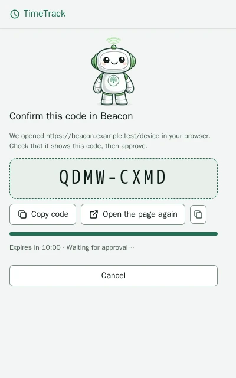 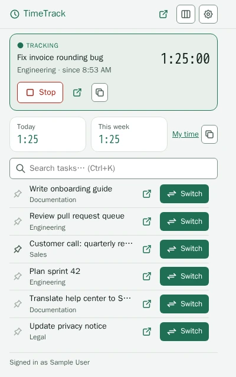

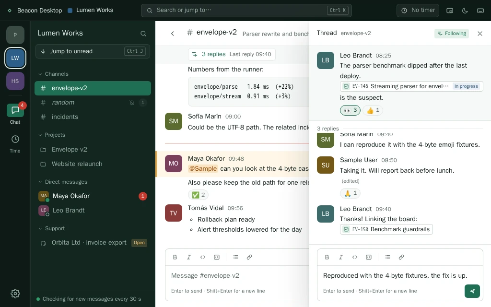

It records only the time you choose to track — see [PRIVACY.md](PRIVACY.md).

### The name, and what is still called TimeTrack

0.9.0 changes only the name people see (design Q-BD-1, option A): window and tray titles, notifications, About, the
Start-menu shortcut, the name in Settings → Apps, the Linux menu entry and the macOS display name say **Beacon
Desktop**. Everything an installed copy depends on keeps its old name, so 0.8.x updates itself in place and keeps its
sign-in and settings: the install folder (`%LOCALAPPDATA%\TimeTrack`), the Uninstall key, the start-at-login value
(`TimeTrack`) and the Windows installer's own title, `TimeTrack.app`, the Debian package and file names
(`TimeTrack_*`), the executable, the bundle identifier and Windows AppUserModelID `tech.nowo.timetrack`, the keychain
entry `tech.nowo.time-track-desktop`, the local settings keys, the updater key and URL, and the release bucket prefix
`time-track-clients/`. `tests/unit/identifiers.test.ts` fails if one of them changes.

## Install

Download the installer from Beacon → **Tasks → Time → Apps** (`/dashboard/tasks/time/apps`); the page shows the
version and SHA-256 of each file. The installers are **not code-signed** (the in-app updates are signed: see
*Updates*), so the operating system warns once:

| OS | File | First start |
|---|---|---|
| Windows 10/11 | `*-setup.exe` (per user, no administrator rights; 0.1.0 also had an `.msi`) | SmartScreen "Windows protected your PC" → **More info** → **Run anyway**. |
| macOS 12+ (Intel and Apple silicon) | `.dmg` | Drag the app (its file is still `TimeTrack.app`) to Applications. First start: right-click (Control-click) the app → **Open** → **Open**. If macOS says the app "is damaged", run `xattr -dr com.apple.quarantine /Applications/TimeTrack.app` once. On macOS 15+: System Settings → Privacy & Security → **Open Anyway**. |
| Linux (x86_64) | `.deb` or `.AppImage` | `sudo apt install ./TimeTrack_*.deb`, or `chmod +x TimeTrack_*.AppImage` and run it. The token is kept in the Secret Service (GNOME Keyring / KWallet). |

Check the SHA-256 shown on the Apps page before installing (`certutil -hashfile <file> SHA256`, `shasum -a 256 <file>`,
`sha256sum <file>`).

### Upgrading on Windows

From 0.4.0 on, the app updates itself, signed and in place. It checks at start and every 6 hours; to check now:

1. Right-click the tray icon (notification area, bottom right) → **Check for updates…**, or open Settings → **Updates**
   → **Check for updates**. Up to date, the app says *Beacon Desktop <version> is up to date*.
2. When a version is available, the card *Version X is available* shows **What's new**, **Update now** and **Later**.
3. **Update now** downloads (with progress), verifies the signature, closes the app, installs and starts it again.
   With a timer running it asks first: *Update now* (the timer keeps running in Beacon) or *After I stop*.

The Microsoft Store build has no *Check for updates*: the Store updates it (Settings → Updates says so).

Running a newer `*-setup.exe` by hand also upgrades in place: it closes the app, tray included (it asks first), keeps your sign-in and settings, and leaves a single entry in Settings → Apps (*Beacon Desktop* from
0.9.0, *TimeTrack* before). If the
installer offers *Uninstall before installing*, either choice works; the second one is quicker.

Coming from **0.1.0**:

- **Installed with `*-setup.exe`**: run the 0.5.0+ `*-setup.exe` (or let 0.4.0+ update itself). The 0.4.0 installer's
  *Uninstall before installing* fails on this install with "Unable to uninstall!": click OK, choose **Do not
  uninstall**, then **Next**; the upgrade is complete and correct.
- **Installed with the `.msi`** (for all users, in `C:\Program Files\TimeTrack`): the 0.5.0+ installer finds it and
  offers to remove it (Windows asks for administrator approval). If you decline, or that fails, or you installed
  0.4.0: open **Settings → Apps → Installed apps**, find the **TimeTrack** whose publisher is **nowo** (version
  0.1.0) and choose **Uninstall** (needs an administrator account), then start the remaining copy (Beacon Desktop). Keep the
  one from publisher **nowo.tech**. Your sign-in is shared, so nothing else to do; if *Start at login* was on, switch
  it off and on again in Settings.

### Two icons in the tray

Up to 0.5.0 a second launch (Start menu or desktop shortcut while the app was hidden in the tray, or a second
start-at-login entry left by an older install) started a second copy with its own tray icon. From 0.5.1:

- **One copy per user session.** A second launch exits at once and brings the running window forward (a second start
  at login, `--hidden`, just exits). Windows: a per-session named mutex; macOS: a local socket (in the shared `/tmp`,
  an upstream limitation: SECURITY.md → *Known limitations*); Linux: a D-Bus name on the session bus (without a
  session bus the app starts unguarded, as before).
- **One start-at-login entry.** At start, an installed Windows copy (`%LOCALAPPDATA%\TimeTrack` or
  `Program Files\TimeTrack`; a copy run from Downloads or elsewhere changes nothing) keeps *Start at login* as a
  single `HKCU\…\Run` value `TimeTrack` for itself, path quoted, and removes its other entries (`time-track-desktop`,
  the 0.1.0 `.msi` copy in Program Files, a per-machine `HKLM` value when it may; `src-tauri/src/autostart.rs`). Only
  the app's own entries count (value name `TimeTrack` / `time-track-desktop`, its executable, an install folder);
  another product's are never touched. Disabled in Task Manager stays disabled, and an app without any entry is
  never switched on. The installer moves the app's value pointing at the 0.1.0 copy to this install even when that
  copy is kept, and removes the app's per-machine value when it runs with administrator rights.
- **Start at login written by the app itself** (Windows): Settings switches one quoted HKCU value, never an
  unquoted or per-machine (`HKLM`) one as the autostart plugin did when the app ran elevated. Switching it on is
  refused from a copy run as administrator or from a copy that is not the installed one (Settings says why).
- **One tray icon per process**: built once in Rust; the webview has no tray permission.

To check by hand (Windows, PowerShell), list what starts at login and what runs:

```powershell
Get-ItemProperty 'HKCU:\Software\Microsoft\Windows\CurrentVersion\Run'
Get-ItemProperty 'HKLM:\Software\Microsoft\Windows\CurrentVersion\Run'
Get-Process | Where-Object { $_.Path -match '(?i)\\(TimeTrack|time-track-desktop)\.exe$' } | Select-Object Id, Path
```

Quit every copy (tray → *Quit*, or `Stop-Process -Name TimeTrack, time-track-desktop`), remove extra entries with
`Remove-ItemProperty 'HKCU:\Software\Microsoft\Windows\CurrentVersion\Run' -Name <name>` (an `HKLM` one from an
administrator PowerShell), or Task Manager → *Startup apps* → disable the duplicate; also delete any TimeTrack or
Beacon Desktop shortcut in `shell:startup` / `shell:common startup` (Win+R). Uninstall a leftover 0.1.0 copy
(publisher **nowo**) and start Beacon Desktop again. A tray icon that stays after its process is gone (killed, crashed) is
a ghost Windows removes when the mouse passes over it.

### Sign in

1. Enter your Beacon URL and click **Connect**. The app asks *Sign in to <host>?* in a system dialog: check the host
   and click **Sign in** (if you did not just ask to sign in, click **Cancel**).
2. The app shows a code like `BCDF-GHJK` and opens Beacon's *Connect a device* page in your browser.
3. Check the code, approve. The app is now listed in Beacon under Account → Security → Time tracking apps, where you
   can revoke it. The session token is stored in the OS keychain only, and only Rust reads it: the app's web view
   never sees it. A system notification confirms every sign-in. If the app ever signs you out because the saved
   server no longer matches the session, revoke the old device there too.

## Chat (0.10.0; sending from 0.12.0)

Beacon chat sits next to the timer: **Chat** and **Time** on the left rail (`Ctrl/Cmd+1`, `Ctrl/Cmd+2`).

1. Open Chat and press **Connect chat**. Beacon asks you to approve a second, separate device request (it only works
   for the person signed in to time tracking). Approve it in the browser page that opens.
2. Pick the organization on the rail (or in the title-bar dropdown, Settings → Organization switcher). The app sends
   it with every request; your web context in Beacon does not change.
3. Read conversations, threads and reactions. From 0.12.0 (Beacon with ChatKitBundle 2.5) write in the message box
   (Enter sends, Shift+Enter adds a line), reply in threads (`R` on a message) and react (`E`, or the chips). An
   approval made with 0.10 / 0.11 reads only: the box offers **Allow sending**, a new approval for reading and
   sending (the read approval is given up first: declining the new one leaves chat disconnected, connect again to
   read). A message that could not be sent shows *Retry* (it is never posted twice) or why the server refused it.
   Notifications come later: use "Open in Beacon" meanwhile.

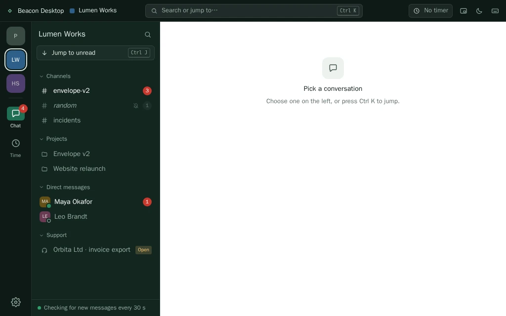 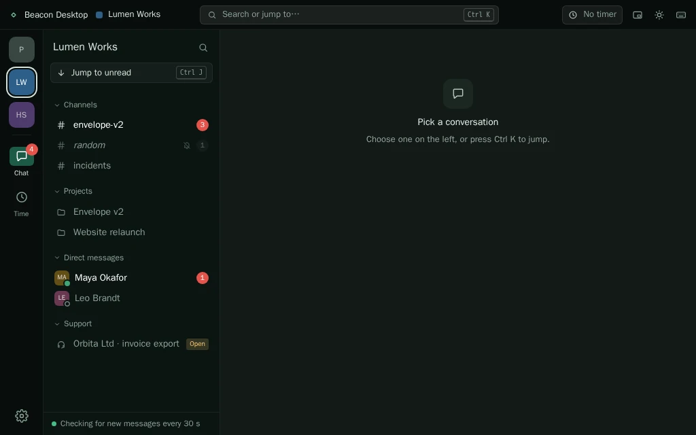

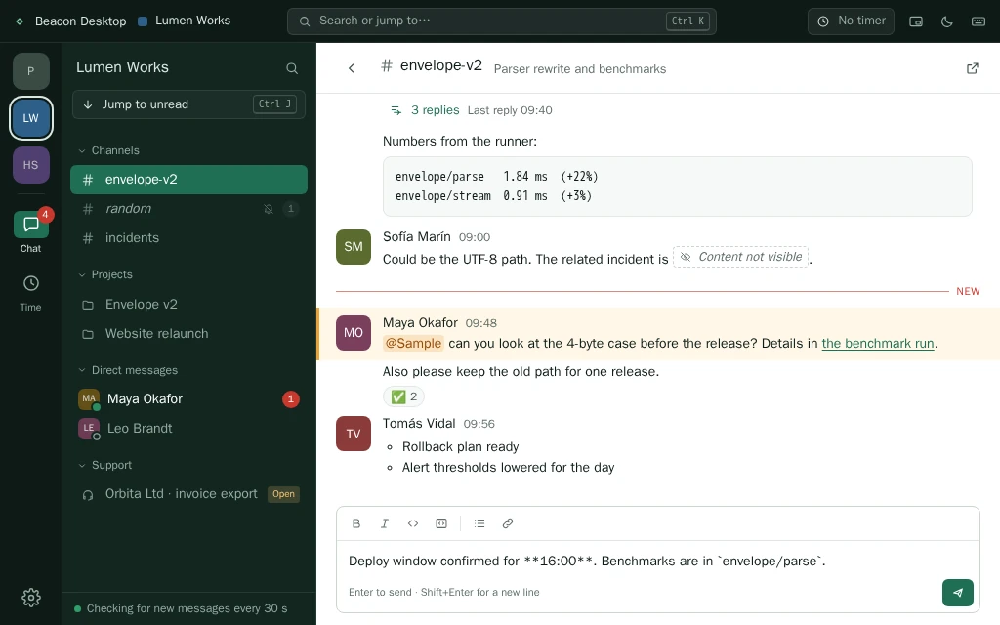 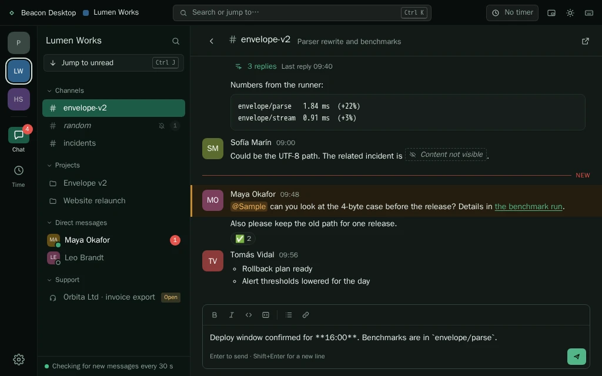

 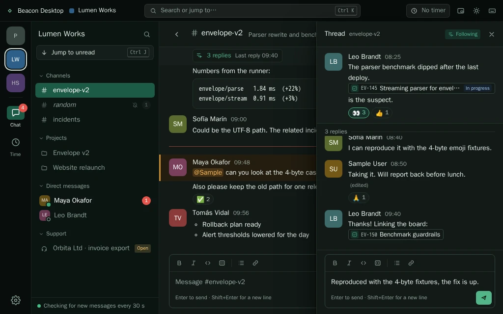

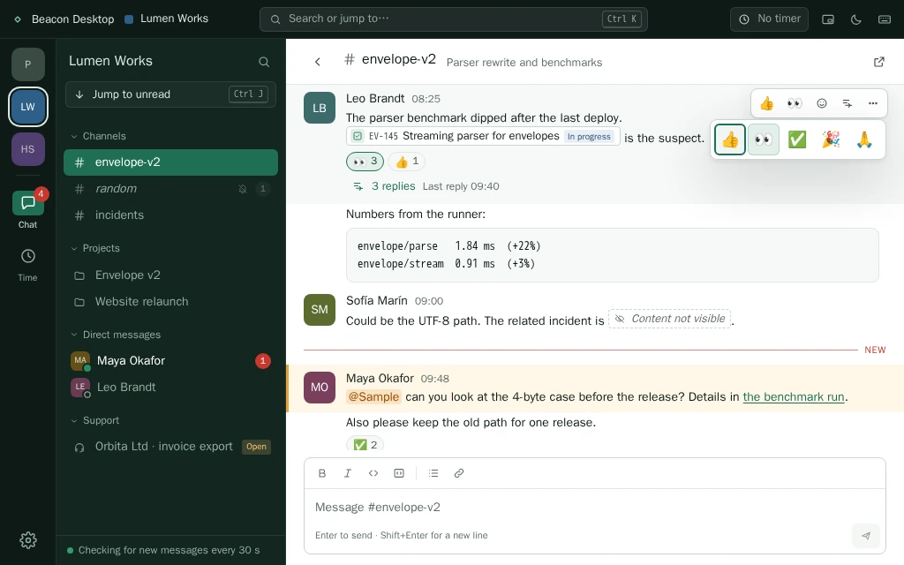 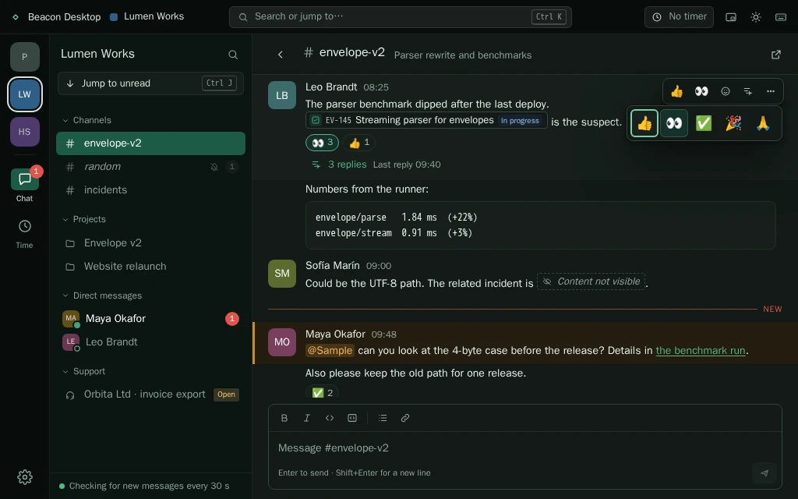

Messages, drafts and unsent messages stay in memory only. "Disconnect chat" (Settings) revokes the chat approval (Beacon with ChatKit 2.4.1; older
servers: revoke the device in Beacon, Account → Security) and removes it from this computer, keeping time tracking
signed in. Needs Beacon with
TimeTrackBundle 2.2 and ChatKitBundle 2.4. Shortcuts: `?` in Chat.

## Organizations, required fields and the mini timer (0.11.0)

- **Organization**: time tracking follows the organization chosen on the rail (or the title-bar dropdown): every
  time request names it, as the chat does. Switching with a running timer stops it first (a timer never keeps running
  in another organization); *Cancel* keeps both. Offline, the switch waits until the time recorded offline (that stop
  too) has been sent; it is always sent in the organization it was recorded in. Resume and pinned tasks only offer
  tasks of the organization shown.
- **Required fields**: when your organization requires an activity type, the app asks for it on stop (default), on
  start, or both (Settings → Time tracking), with an optional client or subject. A stop saved offline keeps your
  answer and the time you clicked; if Beacon still asks for a field when it is sent, the app asks you again.
  "Use the task's last activity type" starts a task with the type you used last with it on this computer.
- **Mini timer**: a small window that stays on top (title-bar button or `Ctrl/Cmd+Shift+M`): the running task, its
  organization and time, Stop / Resume and "Open Beacon Desktop". `Esc` closes it.

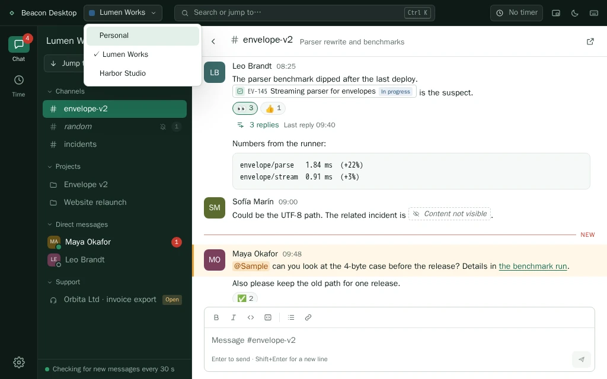 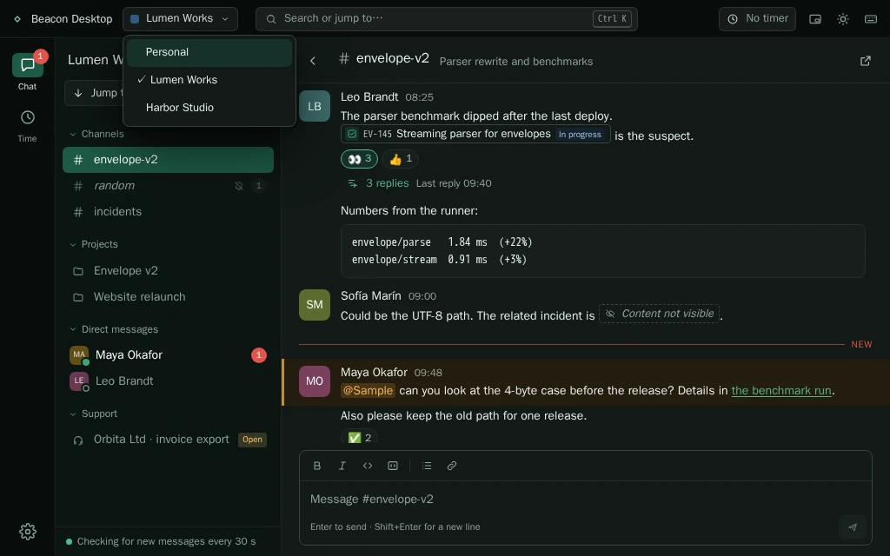

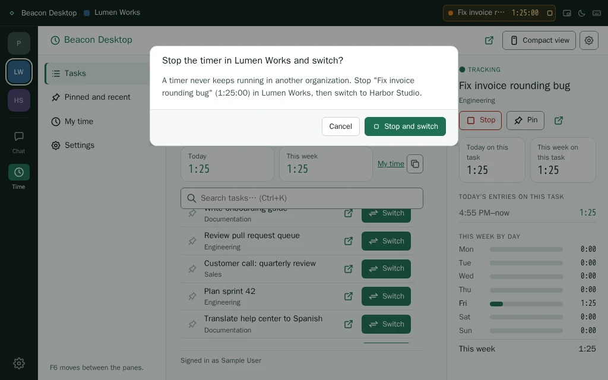 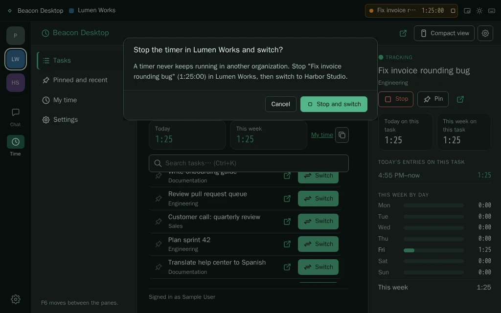

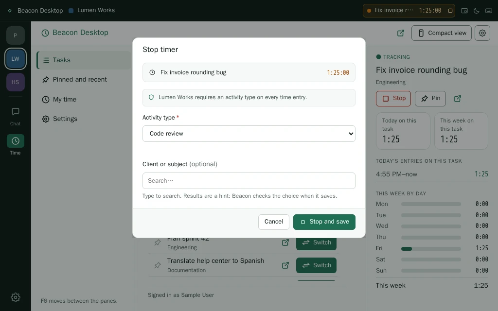 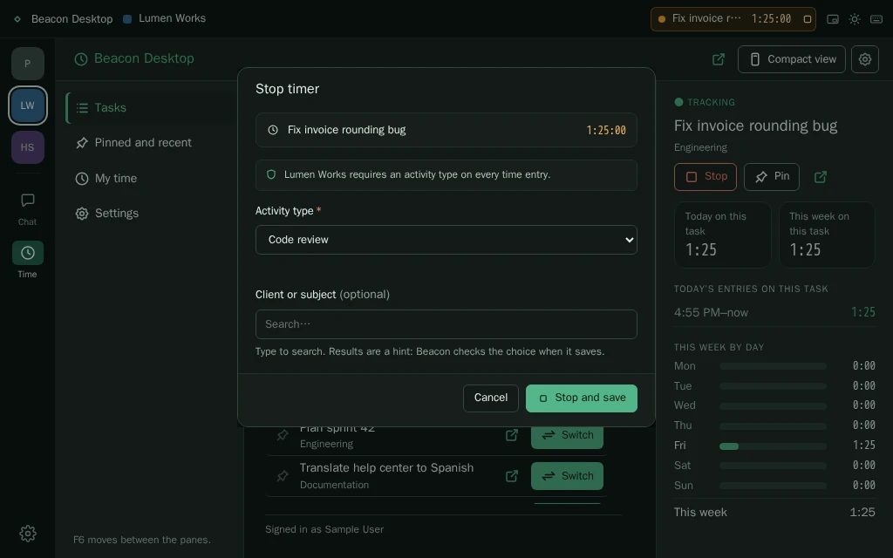

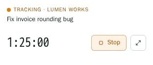 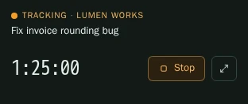

## Features

- Tray timer (`H:MM` and task, tooltip with today's total, running / stopped icon) in the Windows notification area
  (bottom right), the macOS menu bar and the Linux StatusNotifier / AppIndicator, with a translated
  menu: the running task and its time (refreshed every 30 s), Stop / Resume, Switch to (pinned and recent tasks),
  Today's meetings (when there are any), Search task…, Open Beacon Desktop, Full view / Compact view, Open Beacon, My
  time, *Pause friendly messages for 1 h*, Check for updates… (not in the Microsoft Store build), Settings…, Quit. A left click
  shows or hides the window (Windows, macOS; Linux AppIndicators only open the menu). Closing or minimising the
  window keeps the app running in the tray: the timer, the "Still there?" check and the friendly messages carry on,
  woken on time by a wall-clock heartbeat in Rust (`src-tauri/src/heartbeat.rs`), not by the webview's timers, which
  a hidden window may throttle. Global shortcut **Ctrl/Cmd + Alt + Shift + T**, configurable in
  Settings.
- Pinned and recent tasks (`Alt+1…9`), Resume the last task, Today / This week totals, search with `Ctrl/Cmd + K`, arrow
  keys and Enter.
- Two views: the **compact view** (the quick tracker, one centred column up to 900 px wide) and the **full view** (from
  900 px: sections sidebar, task list with the running timer on top, detail pane with the selected task's time today
  and this week and the week by day, also next to Settings and "What we collect"; Settings as a page).
  Switch with the header button, the tray menu or `Ctrl/Cmd + Shift + L`; each view reopens at its own remembered
  size and position, on screen. `F6` moves between the panes. The window cannot be made smaller than the compact view (380 × 560). The window itself never scrolls:
  on the main screen the timer, totals and search stay in place and only the task list scrolls, and every screen
  shares one content width (31 rem in the compact view, 40 rem in the full one).
- **Settings in tabs**: *General* (theme, browser for Beacon links, start at login, what we collect, sign out),
  *Shortcuts*, *Timer* ("Still there?", working without a timer, pause on lock), *Schedule*, *Notifications*
  (friendly messages, desktop notifications), *Meetings* and *Updates* (version, *Check for updates*): a row in the
  compact view (← / →), a vertical list beside the options in the full view when its centre is wide enough (↑ / ↓,
  from about 1100 px; narrower, the row again), so no tab is ever cut off.
  Home and End jump to the first and last tab; the last tab opened is remembered on this computer.
- Device-flow sign-in (no password typed in the app); `401` asks you to sign in again.
- Task search, start / stop / switch. Offline queue: actions taken offline (and "Still there?" answers) are kept on this
  computer, survive a restart and are replayed in order with their real times (`startedAt` / `endedAt`, TimeTrackBundle
  1.10). When the server moves a time (overlap with the previous entry, backdating limit, clock in the future), the app
  says so in plain words. A 1.9 server records an offline start when the connection returns, and the app says that too.
- **"Still there?"** (Beacon spec 199 block 0): while a timer runs, after N minutes without keyboard or mouse input the
  app asks, calmly and without blocking: *Keep* · *Discard* (stop the timer at the idle start) · *Reassign to another
  task…*, then *I was in a meeting or call* (optional note, or count the time on another task on 1.10 servers) and
  *Drop those minutes and keep going*. With no answer within M minutes the timer
  stops at the last input; on return the app asks what to do with the gap, then offers *Resume*. Screen lock and sleep
  count as idle. N and M come from the organisation (`GET me` → `features.idle_check`, `limits.idle_check`; on by
  default there, and the person may only make N longer). On a 1.9 server it is the person's opt-in (default 10 / 5 min).
  The OS idle counter is read locally (`user-idle`) and never stored, logged or sent: only the decision reaches the
  server.
- Privacy screen ("What we collect"): exactly what is sent and what stays on this computer, and **Clear local data**
  (signs out, deletes the token, settings, consents, pinned tasks, queued actions and the idle-check state).
- Optional, off by default, with dated consent: notifications (never outside `me.workingHours`), start at login.
- Auto-update through Beacon (`/api/time-track/updates/desktop/{target}/{arch}/{version}?bundle_type=…`, your token
  as Bearer), signed with the owner's minisign key: checked at start, every 6 h and from *Check for updates* (tray,
  Settings → Updates). A calm card ("Version X is available — What's new · Update now · Later") downloads with progress,
  verifies, installs and relaunches; with a timer running it asks first and offers *After I stop*. An "update
  required" screen when `min_supported_version` (updater body / `X-Min-Supported-Version` / `GET me`) is newer than the
  app and an update satisfying it is offered; it always keeps *Remind me later*, *Download from Beacon* and *Sign out*.
  The Bearer token is never sent to the artifact host (pre-signed URL on another origin); the device verification page
  is opened only when it is https on the server's host.
- Windows: Microsoft Store (MSIX, updated by the Store) or the per-user NSIS installer from Beacon (no UAC). macOS:
  unsigned, see [first open on macOS](docs/guides/macos-first-open.en.md) ([español](docs/guides/macos-first-open.es.md)).
  Plan and owner steps: [docs/RELEASE-PLAN-0.4.0.md](docs/RELEASE-PLAN-0.4.0.md).
- Links back to Beacon: **Open Beacon** and **My time** in the header (and *Open Beacon* in the tray menu), plus an
  "Open in Beacon" icon on each task and on the running timer when the server sends the task's `url`. Only `https:`
  links on the connected server's origin are shown or opened.
- "What we collect" screen.

### Light and dark theme, mascot moments

Settings → General → **Theme**: *System* (default, follows the computer's light / dark setting), *Light* or *Dark*; stored on this
computer and applied to the title bar too. The robot from Beacon shows up in a few friendly moments (sign-in, "You're
in!", saved, a timer left running for 8 hours, no results, offline, updates) and stays out of the running timer and the
task list; which pose goes where, and where the art comes from: [public/mascot/README.md](public/mascot/README.md).

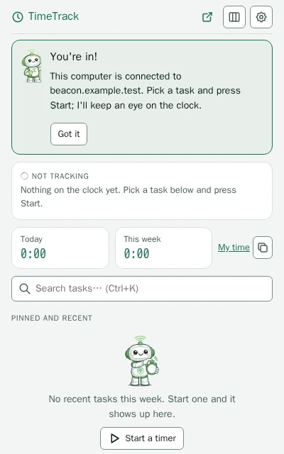 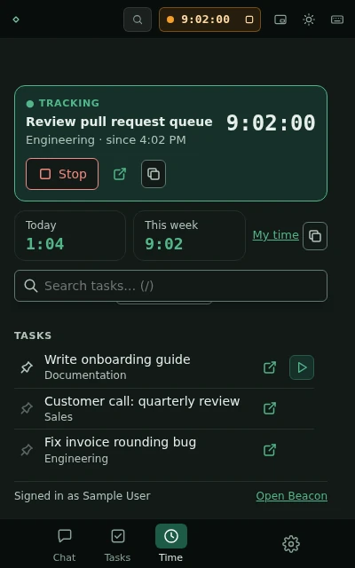 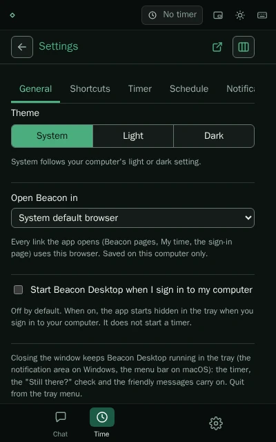

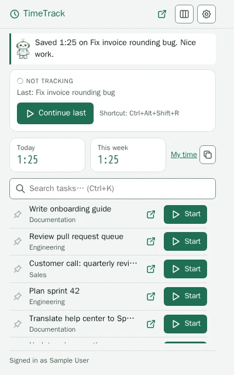 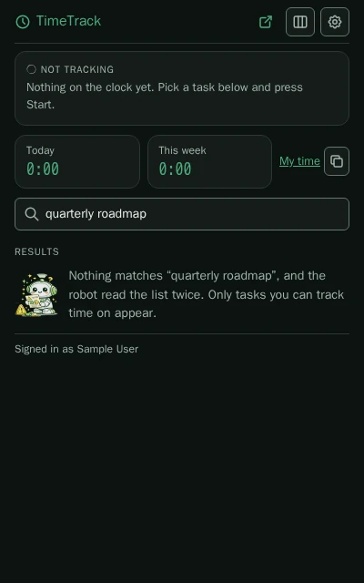 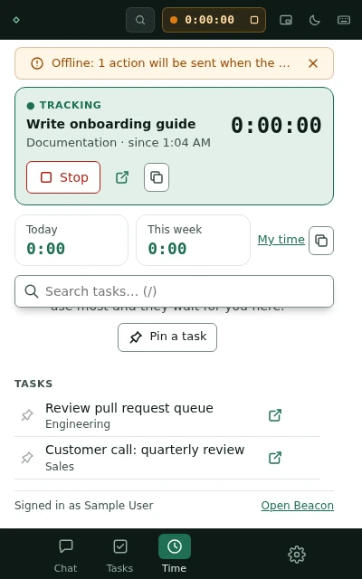

### Friendly messages

A smile now and then, never in the way. While a timer runs, small desktop notifications (outside the app, even with
the window in the tray; a toast inside the window when the OS does not show them) cheer you on after 2, 4, 6… hours (a medal at 2 h and 4 h, a gentle "take a real break" from 6 h, with no figure in
it), greet an early
start, suggest a coffee, lunch, a stretch or some water, say it is getting late, and have something to say on Friday
afternoon and at the weekend. They know about meetings: during a daily, a call or a planning (from Beacon's labels or
the task name) "Still there?" becomes "Still in the meeting?" with a longer countdown, a long meeting is followed by a
coffee / stretch toast, and a finished daily gets a "let's go!". At most one toast every 50 minutes, each moment at
most once a day, never a repeated line among the last six. Written natively in English, Spanish, German, French,
Italian, Dutch and Portuguese (the Beacon user's language when the server sends `me.locale`, else the app's), with
local times per language. Settings → Notifications → **Friendly messages**: *Fun messages* and *Wellbeing reminders*, both on by
default. Pools: `src/lib/messages/`; rules: `src/lib/friendly.ts`.

### Working-hours reminders

Settings → Schedule → **My schedule** holds your week: start, end and lunch break per weekday, or a day off. It is filled in from
the working hours your organisation publishes in Beacon (`GET me.workingHours`; the gap between two slots of a day is
the lunch break) and you can change any value on this computer only; local values are marked *This computer*, and
*Reset to Beacon's schedule* goes back. Holidays and vacations come from Beacon (`GET me.daysOff`, once
TimeTrackBundle publishes them) and from days off you add there.

With *Working-hours reminders* on (default), a desktop notification with a button arrives at your start time ("Shall we
start? Last task: …" → *Start* resumes it), at lunch ("Lunch time. Shall I stop the timer?" → *Stop*; then "Back to
…?" → *Resume*) and at the end of the day ("Shall we call it a day?" with today's total → *Stop*). None on days off,
none that make no sense (no "start" with a timer running, no "stop" without one), each once a day, in the schedule's
time zone, and after a sleep only within 15 minutes of its time. They follow the 1 h pause but not the 50-minute
gap of the friendly messages. Rules: `src/lib/schedule.ts`; texts: `reminders` in `src/lib/messages/`.

"Still there?" itself opens in **its own small window, always on top and centred on the monitor you are using**, also
while the main window is in the tray (`src-tauri/src/prompt.rs`, `src/ui/prompt.ts`), with a countdown (2 minutes, 10
during meetings): with no answer the timer stops at the start of the idle time, and the window offers **Resume …
now** on the same task. There is only ever one; it closes once answered, Esc does not dismiss it, and on Windows it
flashes in the taskbar when focus-stealing prevention keeps it from taking the focus. A small *Open Beacon Desktop* link in
it brings the main window forward. It shows the running task's title above every other window, so it is also visible
to anyone watching a shared screen. Where it cannot open (a plain browser), it is a modal inside the main window.

#### Desktop notifications

| | Where | Picture | Click |
|---|---|---|---|
| Windows 10 / 11 | Bottom right, then the Action Center, under the app's AppUserModelID (`tech.nowo.timetrack` for the NSIS install, `<package family>!TimeTrack` for the Microsoft Store / MSIX package) | The pose as the square app logo of the toast | Brings Beacon Desktop forward (while the toast is on screen) |
| macOS | Notification Center (top right) | The pose as the content image, the app icon as the sender | Brings Beacon Desktop forward |
| Linux | The desktop's notification service (GNOME, KDE, …) | The pose through the `image-path` hint | Brings Beacon Desktop forward (servers that support the `default` action) |

The first time one is due, the app asks the OS for permission (macOS asks you; the others allow it) and explains once,
inside the window, where the messages went (*Keep them inside the app* is one click away). A refusal or a missing
notification service is remembered: the messages stay in the window and Settings → Notifications → Friendly messages says why, with
*Try again*. The pictures are 96 × 96 PNGs built from the poses (`scripts/mascot/notification-art.sh` →
`src-tauri/notification-art/`, listed in `src-tauri/src/pose_art.rs`), compiled into the binary and written to the app
cache on first use. `pnpm screenshots:native` (`NATIVE_SCREENS=<dir>`) renders mock-ups of the three notifications,
the prompt window and the Windows tray menu for review.

Each line has its own mascot pose (`POSE_IDS`). New art goes in as transparent PNGs (or on white) named
`pose-<id>.png`:

```bash
scripts/mascot/import-poses.sh <dir>   # → public/mascot/pose-<id>.webp + @2x (96 / 192 px high), src/ui/pose-art.json
pnpm screenshots:friendly              # every situation in Spanish, light and dark (FRIENDLY_SCREENS=<dir>)
```

The script makes a white background transparent, drops stray fragments at the edges, trims and converts with cwebp and
ImageMagick (in a throwaway Docker container when they are not installed). A pose without art shows its fallback
(`POSE_FALLBACK` in `src/ui/mascot.ts`); no code change is needed.

### Open Beacon in, Copy link

Settings → General → **Open Beacon in**: *System default browser* (default), a browser found on this computer (Windows registry,
macOS LaunchServices, Linux `.desktop` files incl. Flatpak / Snap) or *Custom…*. Every link the app opens uses it, also
links a page would open by itself. If the chosen browser is uninstalled, links open in the system default and the app
says so. Next to My time, a running task's link and *Open the page again* there is a **Copy link** button, and a right
click (long press) on any Beacon link offers *Open in the browser* / *Copy link*; if no browser can be opened the link
is copied instead. When the list is empty the mascot says what to do next: *Pin a task*, *Start a timer* or *Open the
tasks in Beacon*.

### Continue, three answers on return, lock pause and "working without a timer?"

- **Continue last**: one click on the stopped timer card, or the global shortcut **Ctrl/Cmd + Alt + T**
  (**Ctrl + Alt + Shift + R** on Linux, where Ctrl+Alt+T opens a terminal; configurable in Settings, works with the
  window hidden in the tray), starts the last task again as a new entry. The
  tray shows the running time on its own (macOS menu-bar title, tooltip on every system), refreshed every minute by the
  Rust heartbeat (`src-tauri/src/tray_clock.rs`).
- **Three answers on return from idle** (the "Still there?" prompt, its own window or the in-app modal): **Keep** ·
  **Discard** (the timer stops at the start of the idle time) · **Reassign**, which opens a task picker (pinned,
  recent, search, and a quick *Meeting* choice when a meeting-type task exists) and splits the idle span into its own
  entry on that task while the timer goes on (`discard-idle` `reassign` on 1.10 servers, backdated stop / start
  otherwise; not offered on 1.9). The countdown, the automatic stop and *Resume* are unchanged.
- **Pause on screen lock or sleep** (on by default): the OS lock / sleep events (`src-tauri/src/session.rs`: Windows
  WTS session notifications and power broadcasts, macOS distributed notifications, Linux logind) make that time idle;
  on unlock / wake the same three answers.
- **"Working without a timer?"** (on by default): during your working hours, after N minutes of input (10 by default)
  with no timer, a friendly notification with *Start <last task>* and *Choose task*, at most once every 45 minutes,
  in the seven message languages.

### Meeting detection (opt-in)

Settings → **Meetings** → *Notice when I'm in a call and ask what to record it as* (off by default, dated consent).
When Teams, Zoom, Webex, Slack, Discord, Skype, GoTo, Jitsi Meet or a browser (Google Meet, Jitsi or any web call) has
held the microphone for 2 minutes (1, 2, 5 or 10, configurable), the app asks, as a desktop notification with the
teamwork pose and in the window: "Looks like you're in a meeting (Teams). Which meeting is it?" — *Choose task*
(meeting-like tasks first, then pinned and recent, or a search), *Generic meeting* (your generic meeting task, chosen
once and changeable in Settings), *Not a meeting* or *Don't ask for this app*. With a non-meeting timer running it
offers *Switch to the meeting* instead; with a meeting-like task already running (`taskKind`) it does not ask. When
the microphone has been free for a minute: "Meeting over (32 min). Back to <previous task>?" with *Back* and *Stop*.
During the call the "Still there?" prompt uses its softer meeting wording and longer countdown. Questions follow the
1 h pause ("do not disturb"), wait while "Still there?" is open, come at most every 10 minutes, and, with no timer
running, only within your working day (Settings → Schedule → My schedule, days off).

What is read, per OS (`src-tauri/src/meeting/`, every 20 s from the heartbeat, only while the switch is on):

| OS | Microphone in use | Which app |
|---|---|---|
| Windows 10 / 11 | `HKCU\…\CapabilityAccessManager\ConsentStore\microphone`: an app with `LastUsedTimeStop = 0` | Its package family name (`MSTeams_8wekyb3d8bbwe`) or executable path (`NonPackaged`) |
| macOS 14+ | CoreAudio `kAudioDevicePropertyDeviceIsRunningSomewhere` on the default input | The audio process objects (`kAudioHardwarePropertyProcessObjectList`) with *running input*, by bundle id |
| macOS 13 and older | The same | Known meeting apps among the running processes (a guess, `source: fallback`) |
| Linux | `pactl list source-outputs` (PulseAudio, PipeWire-Pulse), not corked; `pw-dump` without `pactl` | `application.process.binary` |

The identity is reduced at once to a fixed app id (`teams`, `zoom`, …, `browser`) or dropped: paths and unknown apps
never reach the UI. No window titles, URLs, chats or audio are read; nothing about it is stored beyond the call's
state (app id, start, end, the answer) in local storage, and nothing is sent (only the timer you choose). Settings
shows what the last check found. `pnpm screenshots:meetings` (`MEETING_SCREENS=<dir>`) renders the questions and the
settings in Spanish, light and dark.

### Meeting reminders (TimeTrackBundle 1.14)

With a Beacon on TimeTrackBundle 1.14 or later and a calendar connected there, the app reminds you before each meeting,
on this computer only (contract §23). Settings → Meetings → **Meeting reminders**: *Remind me before my meetings* (on by default
once a calendar is connected), *Remind me* 5 minutes before (not before, 1, 2, 5, 10, 15, 30 or a custom 1–120),
*Remind me outside working hours* and *on days off* (both off), *When a meeting starts and a timer is running, ask
what to record* (on) and *Pause my timer automatically when a meeting starts* (off).

- The reminder is a desktop notification — title (*Busy* for a private meeting), local time range, "in 5 min", up to
  three internal attendees and the count of external ones — with **Join** (Teams, Google Meet, Zoom, Jitsi Meet and
  Webex links only, opened in your "Open Beacon in" browser) and **Snooze** (until a minute before the start). The
  window shows it too, with *Snooze 1 / 5 min*; without desktop notifications it also opens the always-on-top prompt
  window. More than three at once become one notification.
- When a meeting starts while a timer runs: *Keep timing*, *Pause* or *Track the meeting* (its linked task, or one you
  pick). With the automatic pause, the timer stops and a notification offers *Undo*.
- *Today's meetings* lists the rest of the day in the main window and in the tray, with *Join*.
- Only meetings inside your working hours (Settings → Schedule → My schedule) and never on days off, unless switched on; free,
  all-day and past meetings never remind; each meeting reminds once per start time (a moved meeting reminds again).
- The list (today and tomorrow) is fetched on start, on wake, when the network comes back and every 5 minutes (or
  Beacon's `refreshAfterSeconds`), honouring `429 Retry-After`; it is kept for at most 48 hours so reminders work
  offline ("may be outdated" after an hour) and deleted when you sign out or turn the reminders off.
- Sessions signed in before 0.6 lack the `meetings:read` permission: one card offers *Sign in again to allow meeting
  reminders*. It is a new sign-in: the app revokes the current session in Beacon, signs out, asks *Sign in to <host>?*
  and runs the device sign-in with the new permission. If you cancel, you stay signed out. Older servers simply have no reminders (Settings says why).

The mock server serves `GET me/meetings` (`POST /__mock/config {"meetings": {"status": "connected", "list": [...]}}`;
`"meetingsScope": false` makes it an older server that refuses the scope).

Everything stays on this computer except the entries you confirm — see [PRIVACY.md](PRIVACY.md). What comes next, and
what Beacon Desktop deliberately will not do: [docs/ROADMAP.md](docs/ROADMAP.md).

### Updates

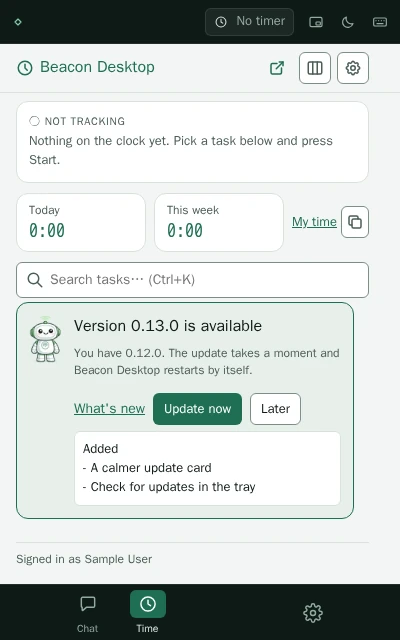 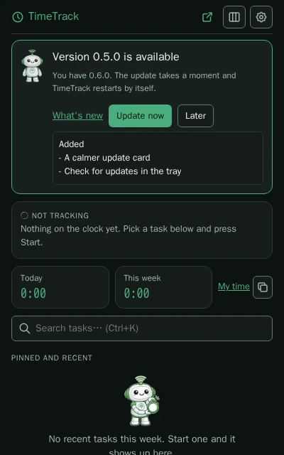 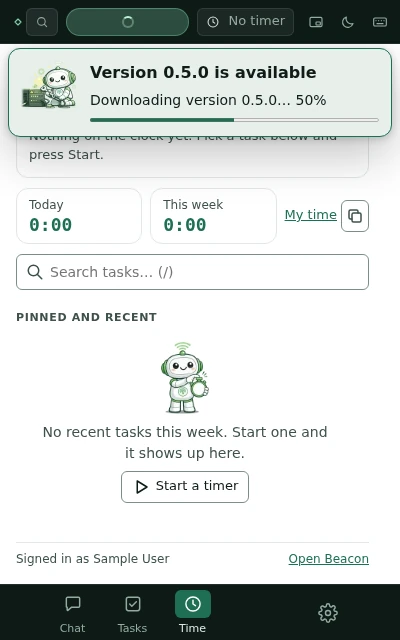

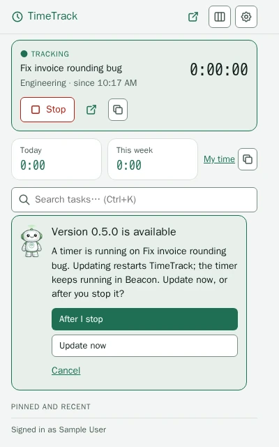 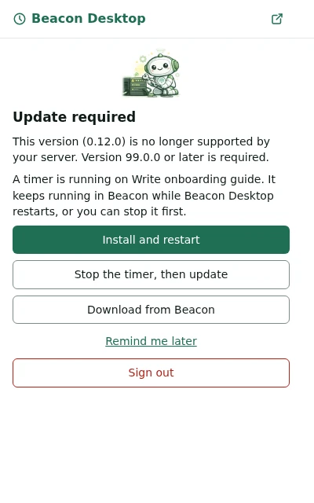 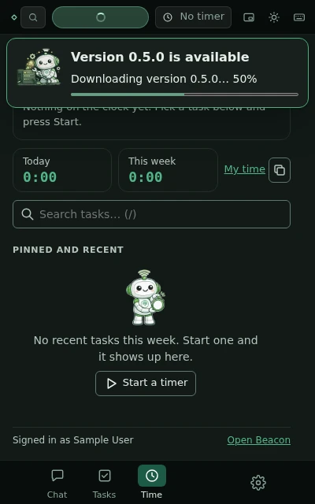

Microsoft Store build (`TIMETRACK_CHANNEL=store`): the Store updates the app, so Settings → Updates and the "update
required" screen send you to the Store listing instead.

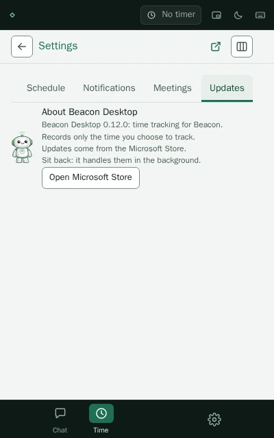 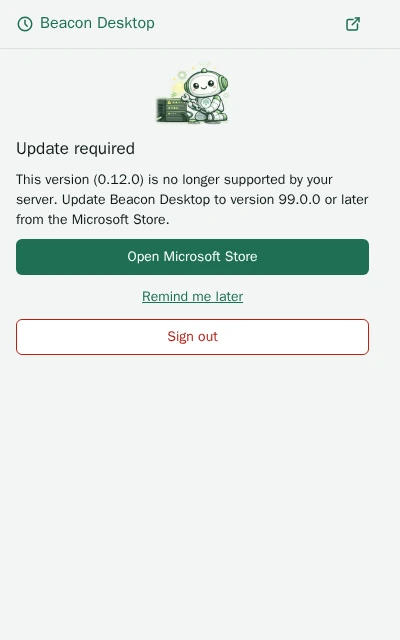

## Security

- **TLS public-key pinning.** Traffic to the official Beacon host (`beacon.nowo.tech`) cannot be read or modified
  even on a network with a TLS-inspecting proxy or a rogue CA trusted by the OS: the Rust HTTP client
  (`src-tauri/src/net.rs`, `src-tauri/src/pinning.rs`) validates the chain against the compiled-in Mozilla roots and
  then requires one of the pinned CA keys (`src-tauri/pins.json`: Let's Encrypt / ISRG roots plus Google Trust
  Services as the backup CA; never the leaf, so certificate renewals every 60–90 days need nothing). On a mismatch the
  app sends nothing and shows *La conexión con Beacon no es de confianza (certificado inesperado)* / *The connection
  to Beacon is not trusted (unexpected certificate)*, with no way to continue. Self-hosted servers keep standard TLS
  validation, shown as *Connection not pinned* in Settings; `localhost` is never pinned. The update check and the
  updater use the same pinned client. Rotation runbook: [docs/PINNING.md](docs/PINNING.md).
- **Self-hosted servers need a publicly trusted certificate.** The app trusts only the Mozilla root store compiled
  into it (`webpki-roots`), never the OS trust store. A self-hosted Beacon behind a private or corporate CA (or a
  self-signed certificate) is **not supported**: sign-in, API calls, the update check and in-app updates all fail
  with a certificate error. Use a certificate that chains to the Mozilla root store (for example Let's Encrypt).
- **Bound to your server.** Every request the app makes and the updater go to the origin (scheme, host, port) of the
  server you signed in to, and nowhere else; switching servers means signing out first. The session token stays
  in Rust with the server that issued it, so even script running in the window cannot read it or send it elsewhere;
  script itself is prevented by the CSP and the text-only DOM (SECURITY.md, *Credentials*). Plain `http://` to `localhost`,
  `127.0.0.1` or `[::1]` works in development (debug) builds only; release builds require `https://`.
- **Chat token apart** (0.10.0). The chat approval has its own token in the OS keychain (`chat-token`), attached by
  Rust to chat routes only; the time token never goes there and the chat token never goes anywhere else. The realtime
  stream runs in Rust and hands the window ids only.
- Reporting and design notes: [SECURITY.md](SECURITY.md).

## Tauri capabilities

- **Every app command is ACL-scoped.** `src-tauri/build.rs` declares them in the app manifest
  (`tauri_build::AppManifest::commands`, list in `src-tauri/app-commands.rs`), so Tauri only lets a window call the
  commands its capability grants (`allow-<command>`); without a manifest any local window could call any command.
  A Rust test checks the list against `generate_handler!` and that each command is granted to exactly one window.
- `src-tauri/capabilities/default.json`, window `main`: core defaults, `beacon_fetch` (every request to your server,
  through the pinned Rust client, only to the origin bound with `beacon_bind` at sign-in; there is no HTTP plugin
  permission), `beacon_bind` and `connection_security`,
  `clipboard-manager:allow-write-text` (*Copy link*), `notification:default`, no autostart permission (*Start at
  login* goes through the app commands `set_autostart` / `get_autostart`), process restart, set theme, and the app
  commands
  `secret_status` / `sign_in_begin` / `secret_delete` (whether a session token is stored, start a sign-in, sign-out;
  no command returns the token, which Rust keeps with the origin that issued it and adds only to requests to that
  origin, `src-tauri/src/secret.rs`), `idle_seconds`, `set_tray_status`, `set_tray_menu`,
  `set_global_shortcut`, `check_update`, `install_update`, `set_wake_plan`, `notify_friendly`, `prompt_open`,
  `prompt_focus`, `prompt_close`, `open_external`, `list_browsers`, `get_browser`, `set_browser`, `pick_browser` (every
  link, in the system default or the chosen browser, launched with an argv array from Rust; no opener permission for
  the webview). The browser choice is kept by Rust (`browser.json`): `open_external` takes only the URL, `set_browser`
  only the default or a detected browser's id, and a custom browser comes only from the native file dialog Rust opens
  itself (`pick_browser`, so no `dialog:allow-open` for the webview); shells, interpreters and launchers are refused. The desktop notifications of the friendly messages go through the app's own
  `notify_friendly` command (Rust, `notify-rust` / `tauri-winrt-notification`), not a new plugin permission.
  The working-hours reminders add no command: their *Start* / *Stop* / *Resume* button travels in `notify_friendly`
  (ids allow-listed in Rust, `notify::ACTION_IDS`) and a press comes back as a `notification-action` event emitted
  to the `main` window only; the next reminder instant rides on `set_wake_plan` (`reminderAt`).
  Meeting detection adds no command and no permission either: the UI turns it on with `set_wake_plan`
  (`micEverySeconds`), the heartbeat sends `mic` events (known app ids only) to the `main` window, and its
  notification buttons (`meeting-generic`, `meeting-switch`, `meeting-back`, `meeting-stop`) join `notify::ACTION_IDS`.
  Meeting reminders add no command and no permission: their buttons are `meeting-<join|snooze|keep|pause|track|undo>:<16
  hex>` (`notify::meeting_action`), the prompt window's answers `meeting-join`, `meeting-snooze`, `meeting-dismiss`, … with a
  16-hex `meeting` field (`prompt::valid_answer`), the tray's *Today's meetings* items `meeting:<16 hex>`; *Join* goes
  through `open_external` from the main window after the meeting-link allow-list (`src/lib/links.ts`).
- No tray permission for any window: `default.json` lists the core defaults one by one (`core:app`, `event`, `image`,
  `menu`, `path`, `resources`, `webview`, `window`) instead of `core:default`, which includes `core:tray:default` and
  would let the webview create a second tray icon. The tray is built once, in Rust (a Rust test checks both).
- `src-tauri/capabilities/prompt.json`, window `prompt` (the "Still there?" window): `core:event:allow-listen` /
  `allow-unlisten` (its content) and `prompt_view`, `prompt_answer`, `prompt_show_main` ("Open Beacon Desktop"). No
  keychain, updater, tray, network, opener, notification, window or autostart permission.
- `src-tauri/capabilities/mini.json`, window `mini` (the mini timer, 0.11.0): `core:event:allow-listen` /
  `allow-unlisten` (its view) and `mini_view`, `mini_action` (`start`, `stop`, `expand`, `close`; anything else is
  refused). The main window opens, updates and closes it (`mini_open`, `mini_update`, `mini_close`) and may bring
  itself forward (`core:window:allow-show`, `allow-unminimize`, `allow-set-focus`) for a dialog it must answer.
- Defence in depth: every command also checks the calling window's label (`main` for the keychain, updater, tray,
  shortcut, heartbeat, notifications and opening / focusing / closing the prompt; `prompt` for reading its view,
  answering and "Open Beacon Desktop"). Answers are allow-listed (`{ action, note?, taskId? }`), pose ids are looked up in
  the compiled-in list (never a path from the webview) and notification texts are capped. On Linux, notification
  bodies are escaped to plain text (`<`, `>`, `&`), since servers with `body-markup` would render markup from a task
  title.
- `tauri.conf.json`: the main window has `backgroundThrottling: "disabled"` (macOS 14+, where WebKit supports it); the
  heartbeat keeps the checks on time on every OS anyway.

## Development

Requirements: Node 24, pnpm (`corepack enable`), Rust stable and the
[Tauri prerequisites](https://v2.tauri.app/start/prerequisites/) (Linux also `libxss-dev libx11-dev libdbus-1-dev`).

```bash
pnpm install
pnpm mock                 # mock Beacon (device sign-in, time API, chat API, updater route) on http://127.0.0.1:8787
pnpm dev                  # UI in a browser (fake platform) on http://127.0.0.1:1420 — handy for UI work
pnpm tauri dev            # the real app
pnpm lint && pnpm typecheck && pnpm test:coverage   # unit tests, ≥ 90% coverage
pnpm exec playwright install chromium && pnpm test:e2e
pnpm screenshots          # regenerates docs/images/*.webp (real UI, fake platform, mock Beacon, placeholder data; captured as PNG, converted with sharp; tests/screenshots/{direct,moments,store,manual}.spec.ts)
(cd src-tauri && cargo clippy --all-targets -- -D warnings && cargo test)
```

The mock's device page is `http://127.0.0.1:8787/device` (approve the code shown by the app). `src/api/` is shared
verbatim with [time-track-extension](https://github.com/nowo-tech/time-track-extension).

## Tests and coverage

Unit tests (Vitest, V8 coverage) gate the build at 90% for statements, branches, functions and lines (`pnpm test:coverage`);
the end-to-end suite (Playwright) runs against the real UI on the fake platform and the mock API (`pnpm test:e2e`), and
the Rust side runs `cargo test`. Coverage measured by CI on `main`:

| Metric | Covered |
| --- | --- |
| Statements | 98.35% (5068/5153) |
| Branches | 94.49% (4363/4617) |
| Functions | 97.79% (1151/1177) |
| Lines | 99.49% (4306/4328) |

## Release

Bump `package.json` and `CHANGELOG.md`, merge, push a `vX.Y.Z` tag. `.github/workflows/release.yml` (tags only) builds
Linux and Windows first, macOS (universal) last, then uploads every file to `time-track-clients/desktop/<version>/` and
writes `time-track-clients/desktop/channel/stable.json` last. Updater signing is required: the build fails without
`TAURI_SIGNING_PRIVATE_KEY` or while `src-tauri/tauri.conf.json` still has the updater public key placeholder
(`pnpm release:check`). A missing S3 secret skips the upload with a notice. Microsoft Store: `pwsh
scripts/store/build-msix.ps1` on Windows (`TIMETRACK_CHANNEL=store`, no in-app updater), upload in Partner Center. Full
steps: [docs/RELEASE-PLAN-0.4.0.md](docs/RELEASE-PLAN-0.4.0.md).

| Name | Kind | Used for |
|---|---|---|
| `TAURI_SIGNING_PRIVATE_KEY`, `TAURI_SIGNING_PRIVATE_KEY_PASSWORD` | secrets | updater signatures (`pnpm tauri signer generate -w ~/.tauri/timetrack.key`) |
| `TAURI_UPDATER_PUBKEY` | variable (optional) | overrides the public key committed in `tauri.conf.json` (`plugins.updater.pubkey`) |
| `MSIX_IDENTITY_NAME`, `MSIX_PUBLISHER`, `MSIX_PUBLISHER_DISPLAY_NAME`, `TIMETRACK_STORE_URL` | variables (optional) | Microsoft Store package (Partner Center → Product identity) |
| `TIME_TRACK_S3_ENDPOINT`, `TIME_TRACK_S3_BUCKET`, `TIME_TRACK_S3_ACCESS_KEY_ID`, `TIME_TRACK_S3_SECRET_ACCESS_KEY` (+ optional `TIME_TRACK_S3_REGION`) | secrets | upload (`s3:PutObject` on `time-track-clients/*` only) |
| `S3_CLIENTS_PREFIX` | variable (optional) | S3 key prefix of every release key (files and `stable.json`; read by `channel.mjs` and `s3-put.sh`); allowlist `time-track-clients` (default) or `beacon-clients`, anything else fails the build. **The Beacon updater must read the same prefix before the variable is flipped**; the app's updater endpoint is unchanged |
| `BEACON_URL` | variable | prefilled server URL |
| `TIME_TRACK_MIN_SUPPORTED_VERSION` | variable (optional) | `min_supported_version` in `stable.json` |
| `LINUX_RUNNER`, `WINDOWS_RUNNER`, `MACOS_RUNNER` | variables (optional) | JSON `runs-on` value per platform, e.g. `["self-hosted","linux","x64","tauri-build"]`; default `"ubuntu-22.04"`, `"windows-latest"`, `"macos-latest"` |
| `WINDOWS_BUILD`, `MACOS_BUILD` | variables (optional) | `false` skips that platform (no entries for it in that version's `stable.json`) |
| `MACOS_CI_ENABLED` | variable (optional) | macOS is **off** unless this is `true` (owner decision 2026-11-06): `release.yml` skips `build-macos` and publishes Linux and Windows only (no macOS entries in `stable.json`), and `platforms.yml` runs Windows only |

Self-hosted runners (build runner spec in `nowo-tech/devops`, spec 024): ephemeral, scoped to this repository, never
the production deploy runner (`prod-vps`). Linux images must carry the Tauri system libraries (webkit2gtk-4.1,
ayatana-appindicator, librsvg, xdo, patchelf), rustup and the AWS CLI; Windows hosts need VS Build Tools (C++),
WebView2, rustup, Git for Windows (`bash`) and PowerShell 7. The workflow only runs on `v*.*.*` tags, never on pull
requests.

Docs: [CHANGELOG](CHANGELOG.md) · [PRIVACY](PRIVACY.md) · [ROADMAP](docs/ROADMAP.md) · [SECURITY](SECURITY.md) · [CONTRIBUTING](CONTRIBUTING.md)

License: [MIT](LICENSE). Third-party notices (`webpki-roots`, CDLA-Permissive-2.0):
[THIRD-PARTY-NOTICES.md](THIRD-PARTY-NOTICES.md).
