# TimeTrack desktop

Tray app (Tauri 2) to start, stop and switch your [symfony-beacon](https://github.com/nowo-tech/symfony-beacon) time
tracking. Talks to the TimeTrackBundle **1.9.0** client API only. Windows, macOS and Linux. English and Spanish.

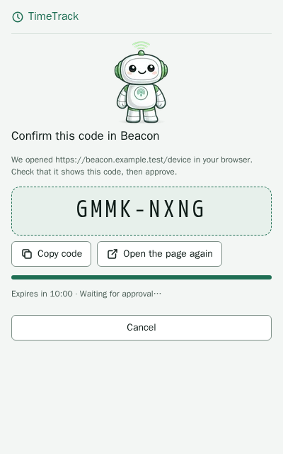 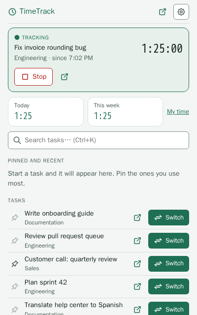

It records only the time you choose to track — see [PRIVACY.md](PRIVACY.md).

## Install

Download the installer from Beacon → **Tasks → Time → Apps** (`/dashboard/tasks/time/apps`); the page shows the
version and SHA-256 of each file. Version 0.1 is **not code-signed** yet, so the operating system warns once:

| OS | File | First start |
|---|---|---|
| Windows 10/11 | `*-setup.exe` (or `.msi`) | SmartScreen "Windows protected your PC" → **More info** → **Run anyway**. |
| macOS 12+ (Intel and Apple silicon) | `.dmg` | Drag TimeTrack to Applications. First start: right-click (Control-click) the app → **Open** → **Open**. If macOS says the app "is damaged", run `xattr -dr com.apple.quarantine /Applications/TimeTrack.app` once. On macOS 15+: System Settings → Privacy & Security → **Open Anyway**. |
| Linux (x86_64) | `.deb` or `.AppImage` | `sudo apt install ./TimeTrack_*.deb`, or `chmod +x TimeTrack_*.AppImage` and run it. The token is kept in the Secret Service (GNOME Keyring / KWallet). |

Check the SHA-256 shown on the Apps page before installing (`certutil -hashfile <file> SHA256`, `shasum -a 256 <file>`,
`sha256sum <file>`).

### Sign in

1. Enter your Beacon URL and click **Connect**.
2. The app shows a code like `BCDF-GHJK` and opens Beacon's *Connect a device* page in your browser.
3. Check the code, approve. The app is now listed in Beacon under Account → Security → Time tracking apps, where you
   can revoke it. The session token is stored in the OS keychain only.

## Features

- Tray timer (`H:MM` and task, tooltip with today's total, running / stopped icon) in the Windows notification area
  (bottom right, like Docker Desktop), the macOS menu bar and the Linux StatusNotifier / AppIndicator, with a translated
  menu: the running task and its time (refreshed every 30 s), Stop / Resume, Switch to (pinned and recent tasks),
  Search task…, Open TimeTrack, Open Beacon, My time, *Pause friendly messages for 1 h*, Settings, Quit. A left click
  shows or hides the window (Windows, macOS; Linux AppIndicators only open the menu). Closing or minimising the
  window keeps the app running in the tray: the timer, the "Still there?" check and the friendly messages carry on,
  woken on time by a wall-clock heartbeat in Rust (`src-tauri/src/heartbeat.rs`), not by the webview's timers, which
  a hidden window may throttle. Global shortcut **Ctrl/Cmd + Alt + Shift + T**, configurable in
  Settings.
- Pinned and recent tasks (`Alt+1…9`), Resume the last task, Today / This week totals, search with `Ctrl/Cmd + K`, arrow
  keys and Enter.
- Device-flow sign-in (no password typed in the app); `401` asks you to sign in again.
- Task search, start / stop / switch. Offline queue: actions taken offline (and "Still there?" answers) are kept on this
  computer, survive a restart and are replayed in order with their real times (`startedAt` / `endedAt`, TimeTrackBundle
  1.10). When the server moves a time (overlap with the previous entry, backdating limit, clock in the future), the app
  says so in plain words. A 1.9 server records an offline start when the connection returns, and the app says that too.
- **"Still there?"** (Beacon spec 199 block 0): while a timer runs, after N minutes without keyboard or mouse input the
  app asks, calmly and without blocking: *Yes, I'm here* · *I was in a meeting or call* (optional note, or count the time
  on another task on 1.10 servers) · *Discard those minutes* · *Pause the timer*. With no answer within M minutes the timer
  stops at the last input; on return the app asks what to do with the gap, then offers *Resume*. Screen lock and sleep
  count as idle. N and M come from the organisation (`GET me` → `features.idle_check`, `limits.idle_check`; on by
  default there, and the person may only make N longer). On a 1.9 server it is the person's opt-in (default 10 / 5 min).
  The OS idle counter is read locally (`user-idle`) and never stored, logged or sent: only the decision reaches the
  server.
- Privacy screen ("What we collect"): exactly what is sent and what stays on this computer, and **Clear local data**
  (signs out, deletes the token, settings, consents, pinned tasks, queued actions and the idle-check state).
- Optional, off by default, with dated consent: notifications (never outside `me.workingHours`), start at login.
- Auto-update through Beacon (`/api/time-track/updates/desktop/{target}/{arch}/{version}?bundle_type=…`, your token
  as Bearer), signed with the owner's minisign key: checked at start, every 6 h and from *Check for updates* (tray,
  Settings → About). A calm card ("Version X is available — What's new · Update now · Later") downloads with progress,
  verifies, installs and relaunches; with a timer running it asks first and offers *After I stop*. An "update
  required" screen when `min_supported_version` (updater body / `X-Min-Supported-Version` / `GET me`) is newer than the
  app and an update satisfying it is offered; it always keeps *Remind me later*, *Download from Beacon* and *Sign out*.
  The Bearer token is never sent to the artifact host (pre-signed URL on another origin); the device verification page
  is opened only when it is https on the server's host.
- Windows: Microsoft Store (MSIX, updated by the Store) or the per-user NSIS installer from Beacon (no UAC). macOS:
  unsigned, see [first open on macOS](docs/guides/macos-first-open.en.md) ([español](docs/guides/macos-first-open.es.md)).
  Plan and owner steps: [docs/RELEASE-PLAN-0.4.0.md](docs/RELEASE-PLAN-0.4.0.md).
- Links back to Beacon: **Open Beacon** and **My time** in the header (and *Open Beacon* in the tray menu), plus an
  "Open in Beacon" icon on each task and on the running timer when the server sends the task's `url`. Only `https:`
  links on the connected server's origin are shown or opened.
- "What we collect" screen.

### Light and dark theme, mascot moments

Settings → **Theme**: *System* (default, follows the computer's light / dark setting), *Light* or *Dark*; stored on this
computer and applied to the title bar too. The robot from Beacon shows up in a few friendly moments (sign-in, "You're
in!", saved, a timer left running for 8 hours, no results, offline, updates) and stays out of the running timer and the
task list; which pose goes where, and where the art comes from: [public/mascot/README.md](public/mascot/README.md).

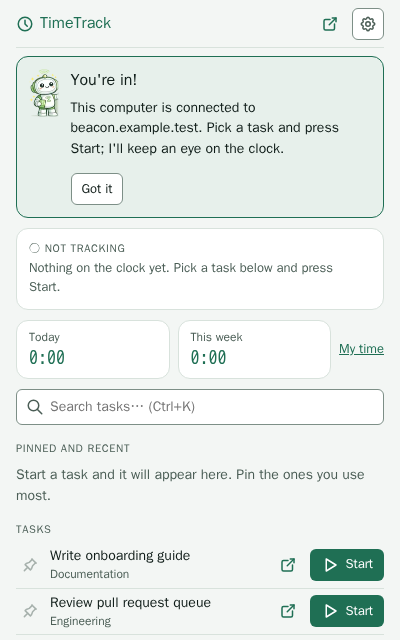 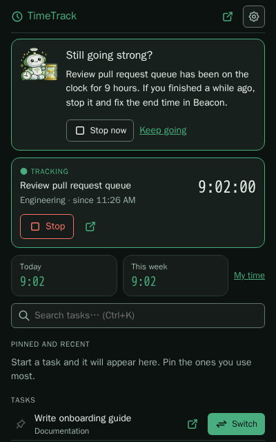 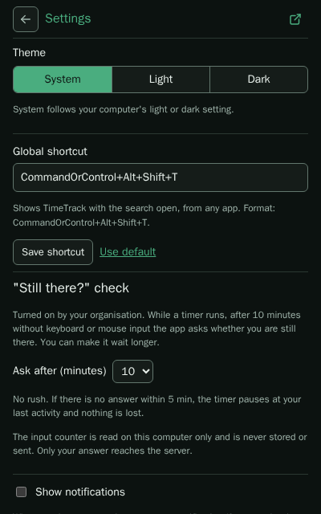

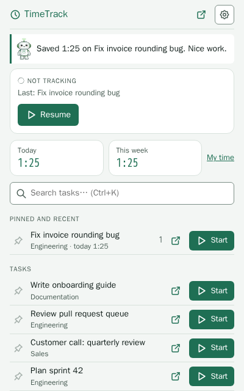 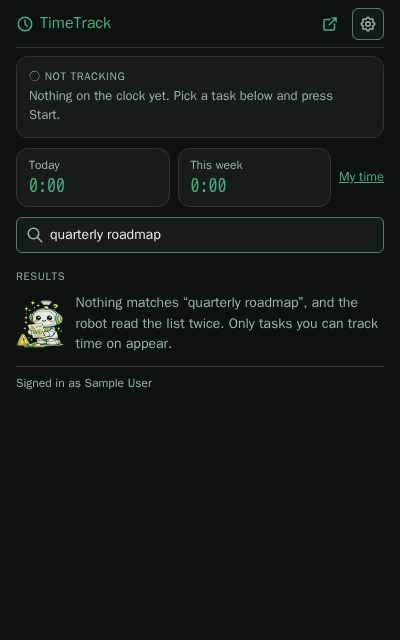 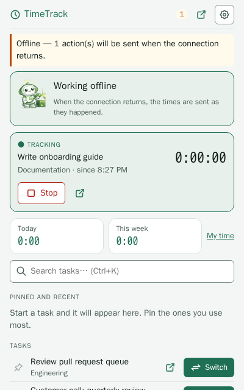

### Friendly messages

A smile now and then, never in the way. While a timer runs, small desktop notifications (outside the app, even with
the window in the tray; a toast inside the window when the OS does not show them) cheer you on after 2, 4, 6… hours (a medal at 2 h and 4 h, a gentle "take a real break" from 6 h, with no figure in
it), greet an early
start, suggest a coffee, lunch, a stretch or some water, say it is getting late, and have something to say on Friday
afternoon and at the weekend. They know about meetings: during a daily, a call or a planning (from Beacon's labels or
the task name) "Still there?" becomes "Still in the meeting?" with a longer countdown, a long meeting is followed by a
coffee / stretch toast, and a finished daily gets a "let's go!". At most one toast every 50 minutes, each moment at
most once a day, never a repeated line among the last six. Written natively in English, Spanish, German, French,
Italian, Dutch and Portuguese (the Beacon user's language when the server sends `me.locale`, else the app's), with
local times per language. Settings → **Friendly messages**: *Fun messages* and *Wellbeing reminders*, both on by
default. Pools: `src/lib/messages/`; rules: `src/lib/friendly.ts`.

### Working-hours reminders

Settings → **My schedule** holds your week: start, end and lunch break per weekday, or a day off. It is filled in from
the working hours your organisation publishes in Beacon (`GET me.workingHours`; the gap between two slots of a day is
the lunch break) and you can change any value on this computer only; local values are marked *This computer*, and
*Reset to Beacon's schedule* goes back. Holidays and vacations come from Beacon (`GET me.daysOff`, once
TimeTrackBundle publishes them) and from days off you add there.

With *Working-hours reminders* on (default), a desktop notification with a button arrives at your start time ("Shall we
start? Last task: …" → *Start* resumes it), at lunch ("Lunch time. Shall I stop the timer?" → *Stop*; then "Back to
…?" → *Resume*) and at the end of the day ("Shall we call it a day?" with today's total → *Stop*). None on days off,
none that make no sense (no "start" with a timer running, no "stop" without one), each once a day, in the schedule's
time zone, and after a sleep only within 15 minutes of its time. They follow the 1 h pause but not the 50-minute
gap of the friendly messages. Rules: `src/lib/schedule.ts`; texts: `reminders` in `src/lib/messages/`.

"Still there?" itself opens in **its own small window, always on top and centred on the monitor you are using**, also
while the main window is in the tray (`src-tauri/src/prompt.rs`, `src/ui/prompt.ts`), with a countdown (2 minutes, 10
during meetings): with no answer the timer stops at the start of the idle time, and the window offers **Resume …
now** on the same task. There is only ever one; it closes once answered, Esc does not dismiss it, and on Windows it
flashes in the taskbar when focus-stealing prevention keeps it from taking the focus. A small *Open TimeTrack* link in
it brings the main window forward. It shows the running task's title above every other window, so it is also visible
to anyone watching a shared screen. Where it cannot open (a plain browser), it is a modal inside the main window.

#### Desktop notifications

| | Where | Picture | Click |
|---|---|---|---|
| Windows 10 / 11 | Bottom right, then the Action Center, under the app's AppUserModelID (`tech.nowo.timetrack` for the NSIS install, `<package family>!TimeTrack` for the Microsoft Store / MSIX package) | The pose as the square app logo of the toast | Brings TimeTrack forward (while the toast is on screen) |
| macOS | Notification Center (top right) | The pose as the content image, the app icon as the sender | Brings TimeTrack forward |
| Linux | The desktop's notification service (GNOME, KDE, …) | The pose through the `image-path` hint | Brings TimeTrack forward (servers that support the `default` action) |

The first time one is due, the app asks the OS for permission (macOS asks you; the others allow it) and explains once,
inside the window, where the messages went (*Keep them inside the app* is one click away). A refusal or a missing
notification service is remembered: the messages stay in the window and Settings → Friendly messages says why, with
*Try again*. The pictures are 96 × 96 PNGs built from the poses (`scripts/mascot/notification-art.sh` →
`src-tauri/notification-art/`, listed in `src-tauri/src/pose_art.rs`), compiled into the binary and written to the app
cache on first use. `pnpm screenshots:native` (`NATIVE_SCREENS=<dir>`) renders mock-ups of the three notifications,
the prompt window and the Windows tray menu for review.

Each line has its own mascot pose (`POSE_IDS`). New art goes in as transparent PNGs (or on white) named
`pose-<id>.png`:

```bash
scripts/mascot/import-poses.sh <dir>   # → public/mascot/pose-<id>.webp + @2x (96 / 192 px high), src/ui/pose-art.json
pnpm screenshots:friendly              # every situation in Spanish, light and dark (FRIENDLY_SCREENS=<dir>)
```

The script makes a white background transparent, drops stray fragments at the edges, trims and converts with cwebp and
ImageMagick (in a throwaway Docker container when they are not installed). A pose without art shows its fallback
(`POSE_FALLBACK` in `src/ui/mascot.ts`); no code change is needed.

### Updates

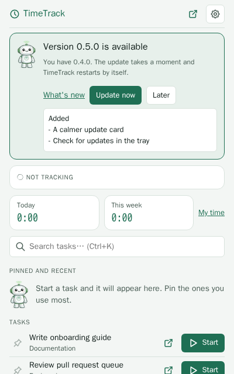 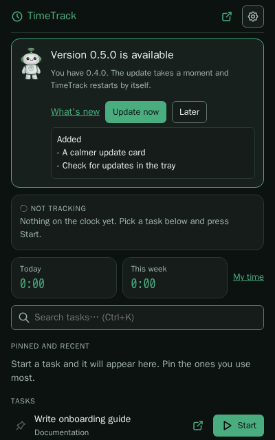 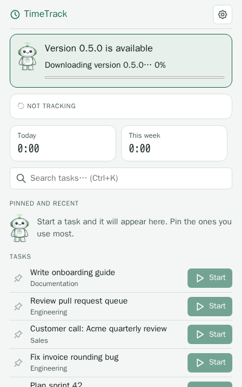

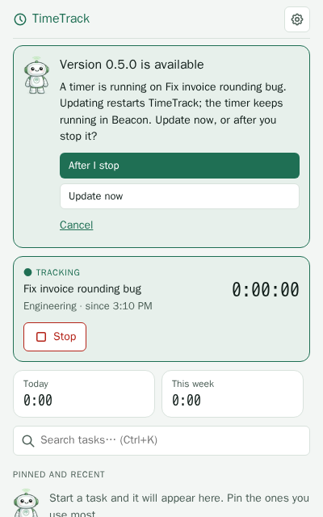 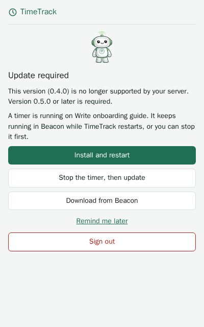 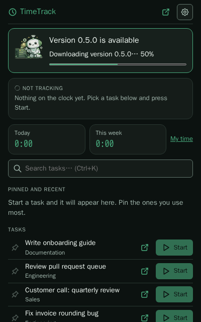

Microsoft Store build (`TIMETRACK_CHANNEL=store`): the Store updates the app, so Settings → About and the "update
required" screen send you to the Store listing instead.

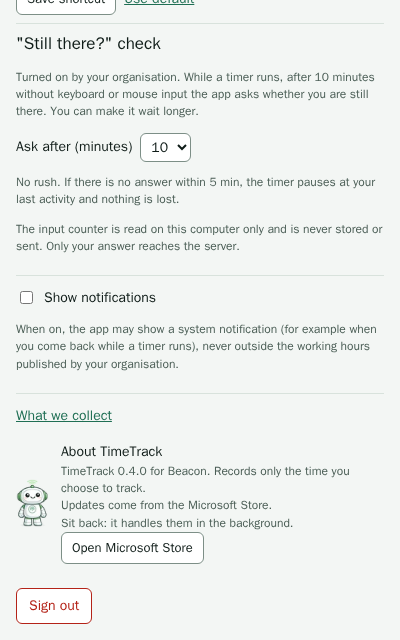 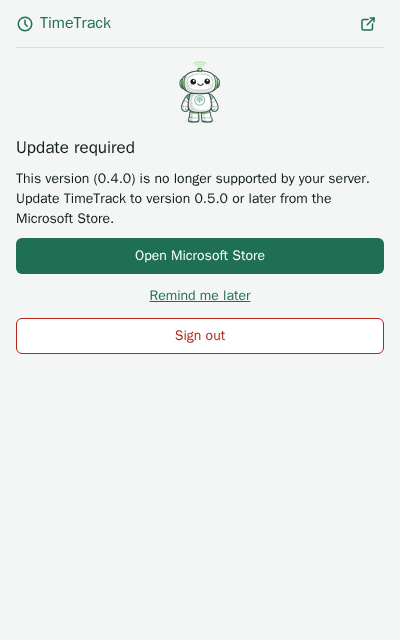

## Security

- **TLS public-key pinning.** Traffic to the official Beacon host (`beacon.nowo.tech`) cannot be read or modified
  even on a network with a TLS-inspecting proxy or a rogue CA trusted by the OS: the Rust HTTP client
  (`src-tauri/src/net.rs`, `src-tauri/src/pinning.rs`) validates the chain against the compiled-in Mozilla roots and
  then requires one of the pinned CA keys (`src-tauri/pins.json`: Let's Encrypt / ISRG roots plus Google Trust
  Services as the backup CA; never the leaf, so certificate renewals every 60–90 days need nothing). On a mismatch the
  app sends nothing and shows *La conexión con Beacon no es de confianza (certificado inesperado)* / *The connection
  to Beacon is not trusted (unexpected certificate)*, with no way to continue. Self-hosted servers keep standard TLS
  validation, shown as *Connection not pinned* in Settings; `localhost` is never pinned. The update check and the
  updater use the same pinned client. Rotation runbook: [docs/PINNING.md](docs/PINNING.md).
- **Self-hosted servers need a publicly trusted certificate.** The app trusts only the Mozilla root store compiled
  into it (`webpki-roots`), never the OS trust store. A self-hosted Beacon behind a private or corporate CA (or a
  self-signed certificate) is **not supported**: sign-in, API calls, the update check and in-app updates all fail
  with a certificate error. Use a certificate that chains to the Mozilla root store (for example Let's Encrypt).
- **Bound to your server.** Every request and the updater go to the origin (scheme, host, port) of the server you
  signed in to, and nowhere else; switching servers means signing out first. Plain `http://` to `localhost`,
  `127.0.0.1` or `[::1]` works in development (debug) builds only; release builds require `https://`.
- Reporting and design notes: [SECURITY.md](SECURITY.md).

## Tauri capabilities

- **Every app command is ACL-scoped.** `src-tauri/build.rs` declares them in the app manifest
  (`tauri_build::AppManifest::commands`, list in `src-tauri/app-commands.rs`), so Tauri only lets a window call the
  commands its capability grants (`allow-<command>`); without a manifest any local window could call any command.
  A Rust test checks the list against `generate_handler!` and that each command is granted to exactly one window.
- `src-tauri/capabilities/default.json`, window `main`: core defaults, `beacon_fetch` (every request to your server,
  through the pinned Rust client; there is no HTTP plugin permission) and `connection_security`, opener,
  `notification:default`, autostart enable / disable / is-enabled, process restart, set theme, and the app commands
  `secret_get` / `secret_set` / `secret_delete`, `idle_seconds`, `set_tray_status`, `set_tray_menu`,
  `set_global_shortcut`, `check_update`, `install_update`, `set_wake_plan`, `notify_friendly`, `prompt_open`,
  `prompt_focus`, `prompt_close`. The desktop notifications of the friendly messages go through the app's own
  `notify_friendly` command (Rust, `notify-rust` / `tauri-winrt-notification`), not a new plugin permission.
  The working-hours reminders add no command: their *Start* / *Stop* / *Resume* button travels in `notify_friendly`
  (ids allow-listed in Rust, `notify::ACTION_IDS`) and a press comes back as a `notification-action` event emitted
  to the `main` window only; the next reminder instant rides on `set_wake_plan` (`reminderAt`).
- `src-tauri/capabilities/prompt.json`, window `prompt` (the "Still there?" window): `core:event:allow-listen` /
  `allow-unlisten` (its content) and `prompt_view`, `prompt_answer`, `prompt_show_main` ("Open TimeTrack"). No
  keychain, updater, tray, network, opener, notification, window or autostart permission.
- Defence in depth: every command also checks the calling window's label (`main` for the keychain, updater, tray,
  shortcut, heartbeat, notifications and opening / focusing / closing the prompt; `prompt` for reading its view,
  answering and "Open TimeTrack"). Answers are allow-listed (`{ action, note?, taskId? }`), pose ids are looked up in
  the compiled-in list (never a path from the webview) and notification texts are capped. On Linux, notification
  bodies are escaped to plain text (`<`, `>`, `&`), since servers with `body-markup` would render markup from a task
  title.
- `tauri.conf.json`: the main window has `backgroundThrottling: "disabled"` (macOS 14+, where WebKit supports it); the
  heartbeat keeps the checks on time on every OS anyway.

## Development

Requirements: Node 24, pnpm (`corepack enable`), Rust stable and the
[Tauri prerequisites](https://v2.tauri.app/start/prerequisites/) (Linux also `libxss-dev libx11-dev libdbus-1-dev`).

```bash
pnpm install
pnpm mock                 # mock TimeTrack 1.9.0 API + Beacon updater route on http://127.0.0.1:8787
pnpm dev                  # UI in a browser (fake platform) on http://127.0.0.1:1420 — handy for UI work
pnpm tauri dev            # the real app
pnpm lint && pnpm typecheck && pnpm test:coverage   # unit tests, ≥ 90% coverage
pnpm exec playwright install chromium && pnpm test:e2e
pnpm screenshots          # regenerates docs/images/*.png (real UI, fake platform, mock Beacon, placeholder data)
(cd src-tauri && cargo clippy --all-targets -- -D warnings && cargo test)
```

The mock's device page is `http://127.0.0.1:8787/device` (approve the code shown by the app). `src/api/` is shared
verbatim with [time-track-extension](https://github.com/nowo-tech/time-track-extension).

## Release

Bump `package.json` and `CHANGELOG.md`, merge, push a `vX.Y.Z` tag. `.github/workflows/release.yml` (tags only) builds
Linux and Windows first, macOS (universal) last, then uploads every file to `time-track-clients/desktop/<version>/` and
writes `time-track-clients/desktop/channel/stable.json` last. Updater signing is required: the build fails without
`TAURI_SIGNING_PRIVATE_KEY` or while `src-tauri/tauri.conf.json` still has the updater public key placeholder
(`pnpm release:check`). A missing S3 secret skips the upload with a notice. Microsoft Store: `pwsh
scripts/store/build-msix.ps1` on Windows (`TIMETRACK_CHANNEL=store`, no in-app updater), upload in Partner Center. Full
steps: [docs/RELEASE-PLAN-0.4.0.md](docs/RELEASE-PLAN-0.4.0.md).

| Name | Kind | Used for |
|---|---|---|
| `TAURI_SIGNING_PRIVATE_KEY`, `TAURI_SIGNING_PRIVATE_KEY_PASSWORD` | secrets | updater signatures (`pnpm tauri signer generate -w ~/.tauri/timetrack.key`) |
| `TAURI_UPDATER_PUBKEY` | variable (optional) | overrides the public key committed in `tauri.conf.json` (`plugins.updater.pubkey`) |
| `MSIX_IDENTITY_NAME`, `MSIX_PUBLISHER`, `MSIX_PUBLISHER_DISPLAY_NAME`, `TIMETRACK_STORE_URL` | variables (optional) | Microsoft Store package (Partner Center → Product identity) |
| `TIME_TRACK_S3_ENDPOINT`, `TIME_TRACK_S3_BUCKET`, `TIME_TRACK_S3_ACCESS_KEY_ID`, `TIME_TRACK_S3_SECRET_ACCESS_KEY` (+ optional `TIME_TRACK_S3_REGION`) | secrets | upload (`s3:PutObject` on `time-track-clients/*` only) |
| `BEACON_URL` | variable | prefilled server URL |
| `TIME_TRACK_MIN_SUPPORTED_VERSION` | variable (optional) | `min_supported_version` in `stable.json` |
| `LINUX_RUNNER`, `WINDOWS_RUNNER`, `MACOS_RUNNER` | variables (optional) | JSON `runs-on` value per platform, e.g. `["self-hosted","linux","x64","tauri-build"]`; default `"ubuntu-22.04"`, `"windows-latest"`, `"macos-latest"` |
| `WINDOWS_BUILD`, `MACOS_BUILD` | variables (optional) | `false` skips that platform (no entries for it in that version's `stable.json`) |

Self-hosted runners (build runner spec in `nowo-tech/devops`, spec 024): ephemeral, scoped to this repository, never
the production deploy runner (`prod-vps`). Linux images must carry the Tauri system libraries (webkit2gtk-4.1,
ayatana-appindicator, librsvg, xdo, patchelf), rustup and the AWS CLI; Windows hosts need VS Build Tools (C++),
WebView2, rustup, Git for Windows (`bash`) and PowerShell 7. The workflow only runs on `v*.*.*` tags, never on pull
requests.

Docs: [CHANGELOG](CHANGELOG.md) · [PRIVACY](PRIVACY.md) · [SECURITY](SECURITY.md) · [CONTRIBUTING](CONTRIBUTING.md)

License: [MIT](LICENSE). Third-party notices (`webpki-roots`, CDLA-Permissive-2.0):
[THIRD-PARTY-NOTICES.md](THIRD-PARTY-NOTICES.md).
